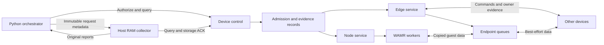
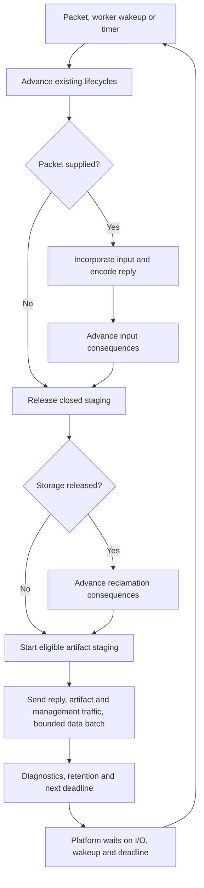
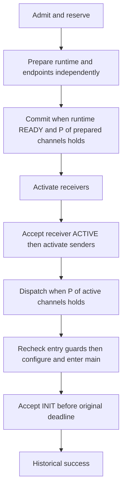

# KaOS graph architecture

The Python orchestrator owns authorization and intended topology. Each device
owns its local resources and execution. A device coordinating an operation
collects evidence from participating owners before declaring its outcome.

## Components and execution

| Component | Responsibility | Source |
|---|---|---|
| Orchestrator, O | Allocate IDs; record immutable requests; reserve intended incidence; fence removal | [orchestrator.py](../../../sim_env/sim_env/orchestrator.py) |
| Shared host | Own the main loop, scheduling, module wiring and artifact/runtime handoff | [host](../../graph_core/kaos_host.c) |
| Control and transport | Route management requests and replies; own bounded peer exchanges | [control](../../graph_core/kaos_control.c), [CoAP](../../graph_core/kaos_coap.c) |
| Artifact pull | Frame requests, validate blocks, bound restart and transfer buffer access | [artifact](../../graph_core/kaos_artifact.c) |
| Platform adapter | Map addresses to enrolled IDs; provide datagram I/O, waits, retained wakeups and locks | [BSD sockets](../../graph_core/ports/host_udp.c) |
| Admission | Atomically check and reserve nodes, endpoints, notification capacity and operation records | [admission](../../graph_core/kaos_admission.c) |
| Node service | Runtime preparation, startup decisions, cancellation and reclamation | [node](../../graph_core/kaos_node.c) |
| Edge and endpoint services | Complete-channel evidence, activation ordering, data permissions, queues and scoped cleanup | [edge](../../graph_core/kaos_edge.c), [endpoint](../../graph_core/kaos_endpoint.c) |
| Runtime | Inert instantiation, guarded guest calls, termination and disposal | [WAMR adapter](../../graph_core/runtime/kaos_wamr.c) |
| Evidence and retention | Cumulative facts, outcomes, aggregate revisions and eligible record retirement | [reports](../../graph_core/kaos_report.c), [admission](../../graph_core/kaos_admission.c) |
| Collector, DB | Retain exact report versions until O acknowledges them | [graph_collector.py](../../../sim_env/sim_env/graph_collector.py) |

`core_host` owns one stable aggregate of admission, control, node, edge,
endpoint and staging state. The POSIX and ESP-IDF entrypoints configure it and
call the same `core_host_run()`. The loop uses `core_host_step()`, also exercised
with an injected clock and I/O in deterministic tests.

One control loop performs short serialized decisions. Persistent workers serve
the bounded node slots; guest execution and runtime destruction happen outside
control transitions. Fixed mailboxes retain INIT and completion evidence even
when ordinary events are full. The host waits on sockets, runtime wakeups and
deadlines, servicing control and cleanup between bounded data batches.

Locks protect admission, permission checks and lifecycle changes. They do not
span guest execution or remote waits. Control taks runs at higher priority than
 WAMR workers to prevent starvation when running compute-heavy nodes.

## Scheduling and task responsibilities

The existing control task owns admission, accepted evidence, lifecycle progress
and reclamation decisions. WAMR workers own preparation, guest execution and
runtime destruction; they publish facts in their mailboxes and retain wakeups
for control. At entry they take the registry lock, read current permission and
time, and keep that lock through WAMR's execution marker. They do not run node
or edge passes or consume another worker's mailbox. Guest data calls still
perform bounded, locked copies through the endpoint interface.

`core_host_step()` makes the scheduling order explicit:

Only the host's `advance_lifecycles()` helper calls the paired node/edge passes.
Each checkpoint first calls `core_node_apply_cleanup()` to select node expiry,
removal and dependency cleanup without consuming runtime completion or INIT.
This prevents activation under a channel deadline that outlasts an expired node
startup deadline. It then performs two bounded edge-then-node rounds. The first can
publish endpoint READY and let the node commit; the second can activate its
endpoints and let the node dispatch. Edge removals are applied before node
startup evidence. This explicit dependency propagation handles local channels
without relying on another packet, another peer exchange or worker-side
scheduling. It is not an unbounded loop seeking a stable state.

The pre-input and post-input checkpoints share the registry lock with packet
handling. No send or allocation occurs between them. The post-input checkpoint
therefore applies an admitted removal before a blocked worker can enter. Staging
free/allocation and network sends release the registry lock; clocks are sampled
again at the relevant decisions. A staging release gets a further checkpoint so
cleanup does not wait for a wakeup that will never arrive.

The platform adapter only waits, attributes packets, sends and wakes. It does
not decide which operation advances. Existing edge interfaces retain their own
deadline guards when issuing effects or accepting owner evidence, and control
handlers can finish synchronous endpoint cleanup before encoding its reply.
Those calls remain on the control task; moving them into workers or removing
them merely to reduce the count of `step` calls would change their contracts.

The host helpers separate artifact eligibility and handoff, management output,
data output, diagnostics and deadline selection. In the node module, named
checks describe local-role liveness, startup authorization and INIT acceptance;
entry and INIT share the same authorization predicate.

## Identity and authority

A channel connects one sending endpoint to one receiving endpoint. Both roles
exist even on the same device. A node's *incidence* is the set of intended
bindings touching that exact instance, including pending and unresolved work.

| Identity | Meaning |
|---|---|
| Logical node | Application identity, independent of a particular execution |
| Operation ID | Non-recycled unsigned 64-bit value allocated only by O; zero is valid |
| Instance ID | The creating node operation's ID, retained for that concrete lifetime |
| Channel ID | Directed triple `(sourceLogical, destinationLogical, serviceId)` |
| Binding | `(channelId, creatingOpId)`; identifies the exact channel creation |

A removal receives a fresh operation ID and targets existing instances/bindings.
Storage slots are separate identities. Lifetime tickets and record incarnations
prevent delayed callbacks from acting on reused slots.

O records intended bindings before dispatch, including work still in transit.
Node removal atomically freezes that complete incidence and excludes new
authorizations. Device admission checks its locally known subset; a local
registry scan cannot discover all outstanding authorizations.

## Operation lifecycle

For a node with dependency predicate P, READY means inert preparation is
complete, ACTIVE enables an endpoint's data permission, and accepted INIT
establishes STARTED for the authorized main invocation:

P supports constants, channel references, AND and OR. A qualifying channel
requires both endpoint roles. For `(A or B) and C`, either complete pair
`{A,C}` or `{B,C}` can support startup. Before dispatch, an alternative may still
become ready; after dispatch, known loss of all active support selects cleanup.
Optional channels keep their deadlines and cleanup obligations after success.

| Operation | Coordinator | Success condition |
|---|---|---|
| Add node without channels | Node host | Accepted STARTED; internally P is true |
| Add node with channels | Node host | Accepted STARTED with P satisfied |
| Add edge | Source host | Both endpoint ACTIVE facts accepted before expiry |
| Remove isolated node | Node host | Node CLEANED; complete incidence must be empty |
| Remove node with channels | Node host | Node and both roles of every scoped binding CLEANED |
| Remove edge | Source host | Both roles CLEANED; peer runtimes remain intact |

Cleanup closes access, cancels work, drains tracked users, releases resources
and reservations, then records CLEANED. Runtime exit or a termination request
alone is insufficient. Failed node construction includes every declared
endpoint, even one whose preparation was never observed. Overlapping removals
share physical cleanup but retain independent evidence and deadlines.

## Evidence and time

| Outcome | Meaning |
|---|---|
| Pending | Success or complete failure closure has not yet been established |
| Succeeded | Addition met its startup/activation gate, or removal obtained full closure |
| FailedClean | Unsuccessful addition obtained full scoped closure |
| Unresolved | Cleanup cutoff passed with missing closure; late evidence may resolve it |

Success is historical, not ongoing health. A successful node may later exit,
and its optional work may remain unresolved. Full distributed removal after
success requires fresh O authorization; safe local reclamation can proceed.

Owner reports accumulate facts for one operation/object/owner: equal sets repeat,
subsets are stale, supersets advance and incomparable sets conflict. Only the
coordinator versions the aggregate snapshot. Storage ACKs identify its exact
`(opId, coordinator, revision)`; they neither establish cleanup nor gate success.
ACKed live reports can become unavailable as history while operational state
remains protected. New evidence makes the newer version available again.

Device retirement protects live resources, pending work and unresolved closure.
Eligible acknowledged records are reclaimed first; admission pressure can then
evict the oldest eligible successful or fully cleaned failure record. Settled
remote-owner records retain cancellation fences until capacity is needed, and
require successful final closure-report delivery before retirement. If all
records are protected, new admissions receive backpressure. The collector keeps
every accepted report version until O acknowledges that exact copy; a newer
version does not replace an older unacknowledged one.

Deadlines use owner-local monotonic microseconds. Acceptance requires
`now < deadline`; equality expires. Retries, queries and phase changes never
renew allowances. Cleanup cutoff stops that attempt's retries while local
cleanup and acceptance of late closure may continue.

## Data and resource bounds

Guests address logical channels through copied, nonblocking `put` and `get`.
Each role owns a FIFO, including separate sender and receiver queues for a
local channel. Successful `put` means local acceptance; receiver overflow drops
the arriving message. There is no delivery, network-order, deduplication or
freshness guarantee. Channel notifications coalesce to the latest unread state.

The [static C profiles](../../graph_core/include/kaos_limits.h) select:

| Limit | Default | Four-node profile |
|---|---:|---:|
| Resident nodes | 2 | 4 |
| Local endpoint roles | 8 | 32 |
| Operation records | 4 | 24 |
| Channels per request / incidence per node | 4 | 8 |
| Ports per node | 4 | 8 |
| Request bytes | 1024 | 2048 |
| Report objects | 9 | 17 |

Both profiles allow up to four 256-byte messages per endpoint. Node budgets
cover the retained artifact plus runtime arena; fixed pools, native stacks,
global runtime storage and platform costs are additional. Admission reserves
peak lifecycle requirements, and unreclaimed resources stay charged.

The current Python encoder retains the default four-channel, 1024-byte request
bounds. Enabling the larger C profile does not enlarge that encoder.

## Boundaries of the baseline

- Participants are crash-stop: a failed process does not recover and resume
  authority in the same deployment. Reboot/rejoin and restoration of O's authority
  are outside the implemented recovery contract.
- Configured UDP peers supply attribution under a trusted-participant
  assumption; cryptographic authentication is absent. CRC32 checks artifacts
  for accidental corruption.
- Discarding rejection history can allow an obsolete ADD/PREPARE to construct
  again. Retained-state and memory-lifetime checks still apply.
- Guests follow the trusted INIT-at-main-entry convention. The marker does
  not independently prove its source-level calling position.

See [verification](verification.md) for the demonstrated profiles and open gates.
