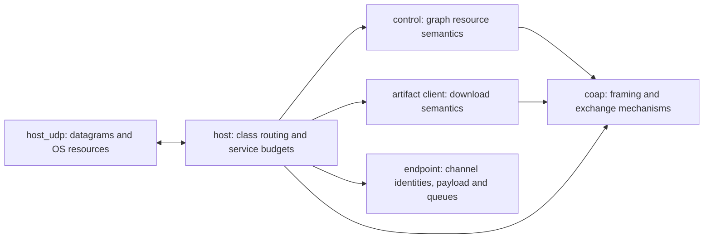
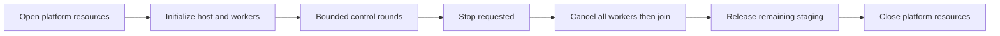
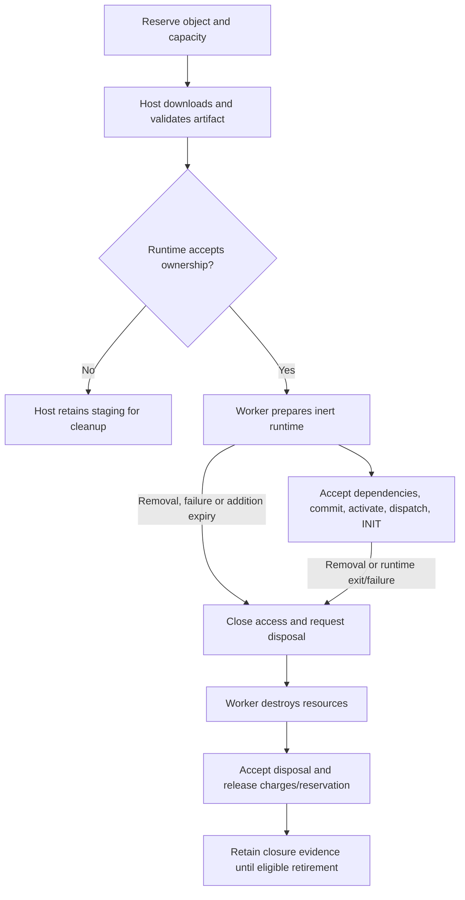

# Graph core simplification and lifecycle readability plan

Date: 22 October 2026. Status: steps 0–6 implemented and verified
([evidence](../verification/graph_core/simplification_verification.json)).
Protocol slice P remains pending the application traffic contract.

Simplify the existing design: place shared UDP beside the existing CoAP source,
reuse CoAP mechanisms already implemented, remove duplicate request decoding,
and expose ordered admission, host service and ownership phases. Keep distinct
node, endpoint, edge and evidence lifecycles. No new transport directory,
transport manager, generic lifecycle engine or dispatch table is needed.
Application traffic is expected to use CoAP too: share its framing/decoding while
retaining two traffic classes. Plan that wire migration separately from refactoring.

## Scope and constraints

Reviewed `graph_core/`, its interfaces, POSIX/ESP-IDF entrypoints/builds, runtime,
verification callers and current design/implementation records, including the
uncommitted two-port scheduler. Legacy root sources and `unicoap/` have separate
build paths; importing or unifying that CoAP stack is outside this refactor.
The refactor preserves simulator wire, launch, observation and readiness behavior.
The application-CoAP slice below intentionally changes application wire framing
and requires coordinated producer/consumer and verification updates.

- For behavior-preserving refactoring, preserve wire bytes, accepted inputs, error
  precedence, output mutation on failure, fixed capacities, stable lifetime
  addresses and nonwrapping tickets.
- Preserve clock samples, lock order, notification timing, bounded service rounds,
  retry/pacing behavior, ownership transfer and stdout/exit behavior. Add no task,
  queue, allocation, persistent state or configurable policy.
- Preserve public host/platform interfaces and existing test sources/assertions.
  Source/include-path changes in build files are allowed. Ask before changing an
  existing test; prior single-port fixture approval is not general permission.
  Add characterization cases where a proposed change lacks coverage.
- Work from the current dirty tree. Capture a baseline before implementation;
  do not reconstruct sources from Git or include unrelated cleanup.

The [codebase-design skill](/home/karolina/.agents/skills/codebase-design/SKILL.md)
provides module/interface vocabulary. Its
[deepening guidance](/home/karolina/.agents/skills/codebase-design/DEEPENING.md)
says “Old unit tests on shallow modules become waste once tests at the deepened
module's interface exist; delete them.” This conflicts with the user's instruction
and is excluded. No issue-tracker or branch workflow is required here.

## Transport: placement, actual overlap and selected changes

### Placement decision

The former `ports/host_udp.c` was already one shared BSD-socket adapter for POSIX
and ESP-IDF. That placement was defensible because it owns OS resources, but it is not a
separate implementation for each target. The previous proposal to put only
`host_udp.c/.h` in a new `transport/` directory added navigation without
consolidating anything. The implemented layout is:

```text
graph_core/
  host_udp.c                  shared sockets, peer addresses, wake, lock, stop
  kaos_coap.c                 wire codec, exchanges, replay cache, Block1 assembly
  kaos_control.c              graph management resources and peer effects
  kaos_artifact.c             artifact validation and its small CoAP client
  kaos_host.c                 bounded scheduling, dispatch, allocation/handoff
  include/host_udp.h          existing adapter types and names
  include/kaos_*.h            existing protocol/domain/platform interfaces
  ports/posix/               clock.c and POSIX startup
  ports/espidf/              clock.c and ESP-IDF startup/configuration
  runtime/                   WAMR integration
```

Moved `host_udp.c` from `ports/` to the root of `graph_core/`, and its header to
`include/`, following the existing source/header layout. Retained `host_udp.h` and
`core_host_udp_*` names; no forwarding headers or API rename. Narrowed its include
from `kaos_host.h` to `kaos_host_platform.h` plus `kaos_admission.h` (which
owns `CORE_MAX_PEERS`); entrypoints include the host declaration explicitly.
Keep the few ESP eventfd conditionals in this shared adapter rather than adding
platform wrapper files. POSIX/ESP configuration validation remains distinct:
loopback CLI restrictions and board wildcard addresses are not equivalent.

Follow-up (22 October): moved each platform-specific clock into its matching
platform directory as `clock.c`, updating the two CMake source paths. Clock
implementation bytes and the shared `core_clock_now()` interface are unchanged.
POSIX core rebuild and `graph_core_foundations` pass; the ESP32 network-host
cross-build also passes with the relocated source. All 89 existing verification
source hashes (including the two step 0–6 additions) remain unchanged. These
follow-up checks postdate the original simplification evidence snapshot.

The build boundary matters more than the folder: POSIX `kaos_graph_host` continues
owning the socket implementation; `kaos_graph_core` and fake-platform checks
remain independent of sockets/pthreads/WAMR. ESP compiles the adapter only with
host support. Update `graph_core/CMakeLists.txt` and verification build references;
preserve P2/P3/P4 targets and unchanged `host_udp_test.c` includes.

### Responsibility boundary

Target after the application-CoAP migration:



This is a call/responsibility diagram, not additional runtime layers. Today UDP
carries CoAP management and raw application DataFrames; after migration it carries
CoAP for both classes. UDP decodes neither. Host uses one CoAP decoding path before
dispatching by traffic class and resource/response role. CoAP already owns framing,
retransmission, correlation, replies, replay and Block1 assembly; application NON
messages reuse framing without acquiring management exchange/replay state.
Control owns authorization, admission, exact owner receipts and cleanup responses;
artifact owns expected size, ETag/block sequence, checksum and restart acceptance.
Keep those policies with their owners, sharing the protocol mechanisms below them.

### Application over CoAP: separate protocol slice

Treat this as the expected direction, with the wire contract still to be fixed.
User clarification (22 October): maximum supported remote rate is a qualification
measurement; required application rate will likely be expressed in an application
manifest whose interface is still being designed. Do not invent a fixed rate cap,
manifest fields or a permanent message-ID exhaustion policy in this refactor.
The simplest initial migration wraps the existing encoded DataFrame in a CoAP
payload. This shares the outer protocol but retains the small payload codec;
it does not yet reduce codec count or justify a generic transport manager.

| Decision | Proposed minimum / remaining contract |
|---|---|
| Application delivery | NON messages, one best-effort send attempt; no per-sample confirmable exchange, retransmission queue or Blockwise transfer. Existing CoAP codec supports NON; control's CON-only request handler remains unchanged. |
| Application resource | Candidate: NON `POST /data`, Content-Format 42, empty token, No-Response option 258/value 26, carrying the existing binary DataFrame. Confirm the accepted profile/response behavior before implementation. Preserve channel, creating-operation and source/destination instance identities and endpoint checks; local deliveries still bypass network encoding. |
| Responses and message IDs | NON removes message acknowledgments, not request/response semantics. Specify response handling or No-Response suppression, MID allocation/reuse, duplicate handling and token use. Do not feed every sample through the current nonwrapping management MID/token allocator or silently add a generic replay cache. |
| Traffic isolation | Keep management/application sockets, configured peer attribution, receive/transmit budgets and fairness. Sharing CoAP does not require merging receive queues. Validate resources against the receiving class; application requests must not enter management handlers. |
| Bounds and compatibility | Check DataFrame plus CoAP overhead against datagram capacity and stack limits without reducing the guest payload allowance. Coordinate network producers/consumers and simulator decoders; do not add raw/CoAP autodetection unless mixed-version operation is explicitly required. |

CoAP NON and response suppression are separate mechanisms:
[RFC 7252 §4.3](https://www.rfc-editor.org/rfc/rfc7252.html#section-4.3),
[RFC 7967](https://www.rfc-editor.org/rfc/rfc7967.html).
Existing tests remain protected: identify concrete fixture/assertion changes and
request approval before editing them; this planning update does not authorize those
edits. New application-CoAP tests can be added independently.

Two independent reviews identified the unresolved issue: unrestricted 16-bit MID
wrap is unsafe; a nonwrapping application counter eventually stops sending, while
reuse embargoes or pacing change service behavior. Response suppression also does
not establish congestion control. Select these rules with the manifest/traffic
contract and measure the resulting supported rate; do not infer a rate from the
MID width. The candidate envelope adds 15 bytes (323 bytes at the current maximum
payload), so datagram capacity is not the immediate constraint.

Known migration sites: host application encode/decode; simulator relay plane
classification (currently inspects the first byte); the existing
`host_transport_scheduling_test.c` and sibling `tests/test_graph_relay.py` fixtures.
The latter test changes require the user's specific approval. Endpoint payload
codec tests and guest observation evaluators can remain unchanged.

### Concrete reductions

| Priority/location | Evidence | Selected change and contract |
|---|---|---|
| T1: `kaos_artifact.c:artifact_options()` | Its four `seen_*` flags and option loop duplicate `core_coap_options_supported()` used by control | Replace the loop with the existing helper and the ETag/Content-Format/Block2/Size2 singleton list. Keep CONTENT code, required options, format 42 and expected-size checks local. Both loops reject duplicate supported options and unknown critical options, and ignore unknown elective options; no new validator is needed. |
| T2: `kaos_host.c:receive()` → `core_control_receive()` | Host decodes a management packet to classify it; control decodes the same request again | Extract the existing control body into `core_control_receive_message()` accepting a borrowed decoded message. Declare it in the existing control header as the decoded-input entrypoint; keep the raw-byte entrypoint for existing callers/tests. Both paths retain capacity-before-mutation and CON/code checks; the raw entrypoint still decodes. Host keeps classification, invalid-packet counters and the schema-4 rejection. Borrowed option/payload pointers never outlive packet handling. |
| T3: `kaos_control.c:route()/path_is()` | Each resource comparison searches the same singleton URI-Path again | Find URI-Path once, then compare that option against the existing resource names. Keep missing/repeated paths as NOT_FOUND; do not reinterpret multiple segments or create a generic router. |
| T4: `host_udp.c:core_host_udp_parse_peer()` | Management/application ports repeat decimal parsing, range and delimiter checks | Share a private decimal-port reader with explicit end position. Keep optional application port, equal-port rejection, IPv4/loopback forms and existing partial-output behavior on failure. Do not merge target-specific CLI policy into it. |

T2 changes an internal calling boundary, not the control policy. Keep this order:
response capacity → decode (raw entry only) → CON/code handling → cached replay →
method → resource/format/options → authorization → multipart assembly → dispatch.
In particular, final Block1 retransmissions replay before a released workspace is
examined. Preserve NOT_FOUND over bad format over bad option, the idempotent
activate/owner paths, and cancellation/cleanup paths that bypass ordinary replay
so later replies can contain stronger cleanup evidence.
T2 remains a behavior-preserving management change. The protocol slice later
extends host decoding to application packets; it does not relax management
validation or route application traffic through `core_control_receive_message()`.

### Similarities that do not justify another abstraction

| Candidate | Decision/reason |
|---|---|
| Merge UDP and CoAP into one `.c` | Reject: the same translation unit would give protocol-only builds OS dependencies or require conditional compilation to recover today's seam. Flat placement provides proximity without coupling builds. UDP has no duplicate CoAP codec/exchange engine to remove. |
| Merge control and artifact clients | Reject: they already share `core_coap_exchange`. Graph responses accept late cleanup evidence before normal exchange processing; artifact responses require exact transfer validation. Artifact send failure can restart a download; graph send failure is packet loss. A generic client would need callbacks/modes for these differences. |
| Allocate IDs → encode → start exchange | Both `core_control_peer_next()` and `core_artifact_client_next()` use this sequence. Keep the three existing calls for now: a wrapper alone saves little; removing the subsequent decode needs a new structured-message start contract. Encoding directly into exchange storage also risks changing failure-state/output contracts. Consider separately only with demonstrated stack/copy savings and equivalence tests. Preserve token/MID consumption on failure. |
| Move artifact CoAP client into `kaos_coap.c` | Reject: this makes the shared mechanism depend on artifact state, reference encoding and restart policy without eliminating code. Keep client construction next to its transfer state. |
| Unify Block1 and Block2 | Reject: inbound tagged request assembly and outbound artifact retrieval have different ownership, bounds, deadlines and duplicate rules. Shared integer option encoding/decoding already exists; a few common bit operations do not justify a transfer framework. |
| ACK/RST/reply construction | Reuse existing `core_coap_reply()`/`core_coap_reset()`. Keep control's small CBOR-format wrapper; it hides representation policy. Host's two-line empty ACK construction does not warrant another exported helper. ACK eligibility for stale CON responses remains in `core_coap_exchange_receive()`. |
| UDP `retry_delay()` | This is CoAP timeout selection in the adapter, not duplicated exchange scheduling. Keep the existing callback, RNG sequence and 2–3 s mapping. Moving it behind a new randomness API would expand this refactor and change fake-platform contracts. |
| Generic cache for all receipts | Reject: CoAP peer/MID response replay, retained operation IDs and owner evidence receipts have different keys and retention semantics. Physical grouping must not erase these distinctions. |

## Other consolidation and readability work

A file count alone is not a useful measure: request decoding and reservation
already share an admission interface. Concatenating them removes no caller
knowledge. The following changes complement T1–T4 without creating new modules.

| Location | Change | Behavior to retain |
|---|---|---|
| `kaos_admission.c:core_admission_reserve()` | Implemented two read-only preflight helpers (`check_scope_node`, `check_scope_channel`); capacity, evidence and publication remain visible in the main function | Compared a four-helper temporary-plan design with this smaller extraction. Selected existing locals, without a new plan struct or copied registry/request. Preserve channel-major first failure, publication/slot order and ticket sequences; cancellation still installs its fence. |
| `kaos_request.c:submit()` and readers | Replace three private Boolean mode flags with named authority/trusted-node/forwarded-prepare/forwarded-cancel modes; split long checks into ordered envelope, identity, descriptor and bounds groups | Keep wrappers, body shapes/native grants and authorization/duplicate order. CBOR reads mutate cursors: do not replace short-circuit reads with eagerly evaluated Boolean variables. |
| `kaos_request.c` + `kaos_edge.c:channel_encode()` | Put channel descriptor encoding beside `read_channel()`, using the existing admission internal header | Keep effect selection and enclosing command construction in edge; exact descriptor wire format stays unchanged. No schema framework. |
| Admission/endpoint/node identity checks | Share only demonstrably identical pure comparisons through the existing admission internal header | Distinguish channel identity, binding identity and full descriptor equality; no struct `memcmp` or generic utilities module. |
| `kaos_endpoint.c` close paths | Share the closed/active updates and final queue notification in one private helper | Keep lifetime closure, fact publication, release and notification ordering in their current callers. |
| `kaos_node.c:core_node_artifact()` | Name read-only operation/runtime eligibility and available execution ownership checks; leave charge/action/submit/rollback sequence visible | Success transfers the buffer to runtime. Failure leaves staging's buffer and artifact charge owned; roll back only the added arena/action. Native grants still require the grant-aware callback. |
| `kaos_endpoint.c:core_endpoint_receive()` | Name binding/source matching separately from permission/access and queue checks | Preserve INVALID → DISABLED → SIZE → FULL precedence, zero-size support and access ticket release. |
| `runtime/kaos_wamr.c` | Inline one-call load/instantiate wrappers; share teardown of fully initialized worker resources; clarify input checks versus mutex-protected availability | Partial initialization remains explicit. Cancel all workers before joining any; destroy WAMR globals last. Keep configuration/main entry permission checks fresh, clock sampling under the original locks, fault classification and notification order. |

Keep node, edge, endpoint, predicate, report and lifetime primitives separate:
worker ownership, distributed coordination, local access, evidence and retention
have different invariants. The previously compared monolithic lifecycle and
explicit event/effect designs require more variants, synchronization or duplicated
state; named phases behind current interfaces remain the simpler choice.

## Host and object lifecycle navigation

Organize `kaos_host.c` around initialization, callbacks, lifecycle advancement,
artifact ownership, traffic service, rounds and shutdown. Keep its five public
operations and `core_host_platform` seam. Rename private helpers to expose purpose
and lock requirements; do not introduce a lifecycle coordinator object.

- `receive_batch()`: make due-timer checks, receive attempt, classification/counting,
  locked packet application and budget continuation visible. Full lifecycle passes
  and due-only checks are distinct; extra passes alter mailbox acceptance timing.
- `send_artifact()`/`artifact_deadline()`: name terminal timeout separately from
  paced-send eligibility; mirror pacing in wake deadlines without extending an
  exchange/operation deadline or adding scheduling state.
- Staging: group successful handoff bookkeeping; keep cancellation/free separate.
  Document helpers that unlock around allocation/free and preserve revalidation,
  detach/free/relock/uncharge order. Keep staging owned by host, not node/CoAP.

| Owned state | Owner and end of ownership |
|---|---|
| Admission scope, reservation, lifetime ledger | Admission reserves/releases; lifecycle owners close and drain. Operation records can outlive physical objects. |
| Staged artifact allocation | Host charges/downloads; successful runtime submission transfers it; otherwise host frees/un-charges. Artifact transfer access and allocation ownership are distinct. |
| Execution record/action | Node control-task code accepts actual runtime disposal, then releases action/charges/reservation. |
| Runtime slot, instance, artifact, arena | Worker destroys resources and returns from relevant callbacks before publishing disposal. |
| Endpoint queue and permissions | Endpoint closes access, drains tickets, releases queue charge and exact binding roles under existing serialization. |
| Distributed effects, reports and fences | Edge accepts attributed facts; admission retains evidence. Exact storage ACK hides one revision; safe forgetting is separate. |





These are ownership reading aids, not new serialized state machines. Channel and
runtime preparation overlap; failed downloads also select cleanup. Optional
channels can remain pending after node startup. The addition deadline is not a
running-node lease; unfinished channels retain their own deadline rules.

Preserve and document these non-obvious ordering constraints:

1. Initial node cleanup precedes exactly two edge-then-node passes; no fixed-point
   loop. Receiver-first activation and original per-object deadlines remain.
2. Runtime mailbox observations process failure/exit before INIT. Workers publish
   facts/check entry permission; the control task accepts lifecycle evidence.
3. `advance_edge_cleanup_and_encode_report()` and indexed cleanup handlers also
   perform synchronous edge/endpoint work to compose replies. The outer host round
   is not the only lifecycle call site.
4. Closing, exited, disposed, reclaimed and CLEANED differ. Current node code
   observes disposal before accepting the worker action and publishing STOPPED.
   Cleanup cutoff can yield Unresolved without freeing owned allocations; later
   disposal can strengthen evidence. Process shutdown does not establish CLEANED.
5. Artifact READY means validated bytes, not node READY. A storage ACK hides an
   exact report revision, not an execution object. Later evidence may reappear.
6. Preserve registry/mailbox lock ordering. Keep guest execution, socket I/O,
   heap allocation/free and joins outside registry critical sections where they
   currently are. Do not make failed/used hosts restartable by resetting records.

Update existing architecture/node-addition guides and declaration comments during
implementation; do not create another competing lifecycle guide.

## Implementation order and evidence

Steps 0–6 are ordered, behavior-preserving changes. The separate protocol slice P
depends on step 2 and a settled application wire contract; it need not wait for
steps 3–6. Keep its wire/test migration separate from lifecycle refactoring.

| Step | Work | Evidence required |
|---|---|---|
| 0 | Capture dirty-tree source/test hashes, configured profiles and contracts | Known baseline; new characterization cases for uncovered behavior |
| 1 | Move UDP/header, narrow includes; T4 parser cleanup as a separate diff | Protocol-only build, UDP/route/launch checks, host profiles and ESP cross-build; exact parser acceptance/output behavior |
| 2 | T1 option reuse, T2 decode-once dispatch, T3 route lookup | CoAP/control/artifact/host cases; valid/malformed differential checks for response bytes, error precedence, counters, replay and state/output mutation |
| 3 | Shared identity/queue-close operations and descriptor codec ownership | Admission/request/endpoint/edge regressions; exact wire output |
| 4 | Admission phases and named request modes | Rejection atomicity, duplicates, cancellation/fences; default/four-node capacity checks |
| 5 | Host phases/staging and node handoff guards | Scheduling/pacing, artifact failure/restart, entry/deadline/removal and real-WAMR barrier schedules |
| 6 | WAMR preparation/teardown readability; guides and combined verification | Partial-init/cleanup, runtime/native imports/barriers, all configured suites and resource comparison |
| P | Application DataFrames over CoAP; common host decoding and class-specific dispatch | New wire/endpoint tests; approved changes to affected existing fixtures; coordinated simulator/peer updates; updated transport guide and resource measurements |

For step 2 specifically cover duplicate supported and unknown elective/critical
options, repeated URI-Path, malformed packets, insufficient reply capacity,
expired/full replay cache, final Block1 retry, stale-CON ACK and late cleanup
evidence. Preserve each client's response/restart policy and retry bytes.

For P, verify maximum/zero-length guest payloads, stale identities, disabled/full
endpoints, wrong-class resources, response suppression/handling, MID/duplicate
rules and unchanged best-effort queue consumption. Under application load verify
management progress and bounded work, including malformed packets and any replies.
Recheck local delivery, both host profiles and ESP build/stack requirements.

Combined verification: **60/60 default**, **34/34 four-node** ASan/UBSan/LSan
CTest entries and **9/9 opt-in runtime process tests** pass. General Python
discovery retains 41 opt-in skips; the default profile skips its three-node local
pipeline. All 87 pre-existing C/H/Python verification sources retain their hashes.
New cases compare 117 raw/decoded control calls and inject failure at every WAMR
worker-creation position (2/default, 4/four). In each profile, 179,139 generated
request/admission and 1,456 UDP-parser comparisons match the captured baseline.
Protocol-only build/check and ESP-IDF v5.5 four-node network-host cross-build pass.

Fixed host/admission/control/node/endpoint/edge/staging/UDP record sizes are
unchanged on native and ESP32 compilers. Xtensa `-Og` reports retain 1232-byte
frames for `core_host_step` and `receive_batch`; the host's decoded control
handler frame falls from 352 to 128 bytes. Extraction also adds call overhead:
the standalone raw wrapper plus decoded handler totals 416 bytes versus 352,
and UDP parsing adds a 48-byte helper frame. Endpoint matching and handoff helpers
also add frames; full per-function reports are retained. These are compiler frame
comparisons, not maximum call-chain or hardware high-water measurements. No stack
configuration or capacity was changed. Physical stack/timing qualification remains
open, as before this refactor.

The [verification record](../verification/graph_core/simplification_verification.json)
retains results, baseline/source hashes, incremental source diff, compiler reports
and commands. Steps 0–6 remove duplicated policy and clarify ownership without
changing the tested behavior. P remains pending the agreed wire/traffic contract,
coordinated peer changes and approval for its specific existing-test edits.

Formatting follow-up (22 October): added formatting guidance (now in
[AGENTS.md](../AGENTS.md#c-formatting-and-readability)) and the root
`.clang-format`, pinned to the available clang-format 14.0.4. Reviewed/formatted
all 40 graph C/H files (39 changed). Include order, string literals and code
tokens are preserved by the mechanical pass. Added semantic separators around
validation, publication, handoff and cleanup. Thirteen functions in admission,
CoAP option lookup, endpoint queues, host artifact sending and node startup use
equivalent early guards to reduce nesting; no new helpers or state. Genuine
channel/role iteration and lock-protected common tails remain structured.
The current working-tree snapshot is the baseline; existing verification sources
and retained evidence are protected. The formatting verification record is
`verification/graph_core/formatting_verification.json`.
Final checks pass: formatter 40/40 files; sanitized default 60/60 and four-node
34/34; opt-in runtime 9/9; ESP32 network-host cross-build. All 94 captured
verification C/H/Python sources (including archived harnesses) retain their
hashes. The mechanical pass changes no code tokens. Native `-O2` comparisons
match 26/36 objects; differences are confined to the five files with guard
rewrites in both profiles. No physical timing or stack qualification is claimed.

## References

- [Architecture](../guide/architecture.md), [node addition](../guide/node-addition-walkthrough.md), [verification](../guide/verification.md).
- [Design principles](graph_operation_design_principles_summary.md), [implementation plan](graph_operation_implementation_plan.md).
- Prior [lifecycle](../verification/graph_core/lifecycle_refactor_verification.json), [control](../verification/graph_core/control_refactor_verification.json) and [transport](../verification/graph_core/transport_scheduling_verification.json) evidence.
