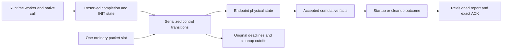

# Host execution composition: bounded evidence and remaining work

`HostExecution.tla` combines runtime ownership, endpoint facts, startup
acceptance, cleanup, deadlines, bounded queues, and report identity in one
finite model. It adds composition evidence to the existing lifetime,
admission, runtime, and wakeup models. **It does not close Q14.** It is a
handwritten abstraction with a handler map, not a machine-checked refinement
of the C implementation.

The retained evidence is
[`../results/continuation/formal/host_execution_verification.json`](../results/continuation/formal/host_execution_verification.json).
That manifest records commands, exit codes, tool and input hashes, exact input
snapshots, logs, and the distinction between completed checks, reachability
witnesses, and incomplete searches.

## State and boundaries

One focal node retains a worker and two abstract storage units from preparation
through disposal. Preparation, configure/main entry, a native call, access
drain, disposal publication, and control acceptance are separate transitions.
A second admitted runtime represents unrelated work that must still finish
while the focal native call is blocked.

Each channel has a sender and receiver. An endpoint's physical phase and its
owner's cumulative facts are separate from the facts accepted by the
coordinator. Sender activation requires accepted receiver ACTIVE evidence.
Local endpoint preparation and cleanup are bounded control work; no endpoint
worker pool is invented. When data access is disabled, a bounded local scan
is collapsed into one transition. With data enabled, endpoint close, access
drain, reclamation, and acceptance are separate.



INIT acceptance checks the current deadline, dispatch, commit, a satisfying
set of accepted ACTIVE channel pairs, and physical usability of local roles.
Physical remote state is not treated as information automatically available
to the coordinator. Success remains historical after later removal or exit.
Node CLEANED requires disposal, drained runtime access, and reclamation of
every incident local endpoint; remote endpoint closure remains a separate
aggregate obligation.

The model has capacity one for ordinary packets, data per channel, and guest
errors; reserved completion and INIT state cannot be displaced by those
queues. Notifications retain their latest state. One exchange and one
in-flight command model a peer, with at most two transmissions per exchange.
Generation 0 can retire and be replaced by generation 1. A copied report,
command, and ACK may survive that replacement; new native grants do not.

Deadline booleans represent crossing an original deadline, rather than
resettable timer objects. Channel cleanup and explicit removal have separate
cutoffs. Late cleanup facts cannot be accepted before recording the applicable
cutoff. The model abstracts elapsed durations and numerical scheduling bounds.

## Handler map

| Model transitions or state | Implementation responsibility |
| --- | --- |
| `FairService`, `Urgent`, serialized transitions | `core_host_step` and `advance_lifecycles` in `graph_core/kaos_host.c`: bounded lifecycle passes around input, with expiry before queued input |
| `PrepareComplete`, `BeginConfigure`, `EnterMain`, `NativeEnter`, `NativeReturn` | Runtime callbacks and retained execution ownership in `graph_core/kaos_node.c`; WAMR call lifetime in `graph_core/runtime/` |
| `Commit`, `Dispatch`, `AcceptInit` | `startup_authorized`, `advance_node_startup`, `init_acceptable`, `accept_node_init` in `graph_core/kaos_node.c` |
| `CloseNode`, `Stop`, `Dispose`, `AcceptDisposed`, `AcceptNodeClean` | Node cleanup and `reclaim_node_execution`; `core_admission_release_node` checks local endpoint reservations |
| Local preparation, activation, close, and acceptance | `advance_channel_preparation_and_cleanup`, `activate_local_channel_endpoints`, `local_observations` in `graph_core/kaos_edge.c` |
| `IssuePrepare`, `IssueActivate`, `IssueCleanup`, `Transmit`, `DeliverCommand` | Edge effects, control peer exchange, and indexed-command handlers |
| `ReportArrival`, `ServicePacket`, `seen` | Endpoint owner reports and authorized cumulative observation acceptance |
| `ExpireChannel`, `ChannelCutoff`, `RemoveNode`, `RemovalCutoff` | Optional-channel cleanup and explicit removal with their original allowances |
| `Query`, `QueueAck`, `DeliverAck`, `retained` | Report query, `storage_ack`, `core_admission_acknowledge`, and revision-sensitive retention |
| `Retire`, `FreshInstance`, generation checks | Record lifetime, exact incarnation identity, and owned per-request native grants |

This mapping records intended correspondence. It does not prove that every
statement in a C handler implements exactly one modeled transition.

## Completed checks

Both completed configurations explore their entire finite state space without
state or depth constraints. TLC used one worker and seed 42.

| Configuration | Scope | Generated / distinct states | Depth | Result |
| --- | --- | ---: | ---: | --- |
| `HostExecutionRuntime.cfg` | Fresh node, ordinary packet/error interference, native return, access drain, unrelated runtime, removal and deadlines; no channels | 86,753 / 18,340 | 24 | Exhaustive pass, 29 s, exit 0 |
| `HostExecutionNativeBlocked.cfg` | Already successful node, a native call that may never return, unrelated cleanup and removal cutoff; no channels | 9,113 / 2,040 | 16 | Exhaustive pass, 4 s, exit 0 |

The runtime check exercises ownership, reserved INIT publication, historical
success, deadline-sensitive acceptance, cleanup, and fair progress. The
blocked-native configuration deliberately does **not** require local cleanup
to finish: native execution retains ownership. It does require unrelated
cleanup and an eventual removal outcome to progress under the stated fairness
assumptions.

`OutcomeProgress` is already true in the blocked-native initial state because
that scenario starts after success. Its useful progress checks are
`BackgroundProgress` and `RemovalOutcome`. The channel, stale-identity, and
archive invariants are vacuous in these two channel-free configurations;
they are not counted as completed verification of those mechanisms.

## Reachability witnesses

`HostExecutionWitness.tla` negates a desired reachable condition as an
invariant. TLC must report **that exact invariant** and retain its trace.
Exit 12 is expected for these searches; it is not an exhaustive safety pass.
The other listed safety invariants remain enabled during the search.

| Configuration suffix | Required reached condition | Distinct states | Time |
| --- | --- | ---: | ---: |
| `WitnessStartup` | Successful startup from a fresh admitted node | 1,540 | 2 s |
| `WitnessNativeDrain` | Native call still pinned while removal reaches its cutoff and unrelated runtime becomes clean | 1,095 | 1 s |
| `WitnessQueuePressure` | Native call, held endpoint access, queued data, and an occupied ordinary packet slot simultaneously | 513 | 2 s |
| `WitnessStaleTraffic` | A new generation coexists with an old command, report, and ACK | 218 | 1 s |
| `WitnessOptionalOverlap` | Historical startup success, incomplete optional branch past cleanup cutoff, and explicit node removal | 21,955 | 8 s |

The stale-traffic scenario starts with a fully cleaned old generation and
delayed copies from that generation. It establishes that reuse is reachable
with all three old message kinds still present; it does not establish the
entire old generation's construction history.

The optional-overlap witness uses the mixed predicate
`(a AND c) OR (b AND c)`, with `c` already active. Its witness-only constraint
keeps startup possible until success, and its witness-only transition guard
delays node removal until an incomplete branch has reached its cutoff.
These restrictions select a reachable example from the main transition
system. They are not used in any exhaustive check.

## Incomplete searches

These configurations were stopped intentionally after state growth. No
counterexample was reported before termination, but unexplored states and
temporal obligations remain. Exit 143 and the last printed progress sample
are retained. Counts below are progress samples, not completed state totals.

| Configuration | Intended additional coverage | Last distinct states | Queued at sample |
| --- | --- | ---: | ---: |
| `HostExecutionRemote.cfg` | Remote receiver, owner evidence, delivery, startup and cleanup | 53,092 | 28,118 |
| `HostExecutionMixed.cfg` | Three local channels, mixed predicate, optional expiry and removal | 1,175,700 | 567,514 |
| `HostExecutionReuse.cfg` | Exact revision ACK, retirement, new generation, stale copies | 1,098,699 | 503,176 |
| `HostExecutionPartition.cfg` | Unreachable remote owner, deadlines and local cleanup | 52,040 | 25,267 |
| `HostExecutionLocalData.cfg` | Data, endpoint access, native/runtime interference, cleanup | 30,584 | 19,192 |

## Coverage limits and Q14 work remaining

| Obligation | Evidence here | Remaining work |
| --- | --- | --- |
| Worker/native ownership and unrelated progress | Two completed checks and blocked-native witness | Explicit shared host schedule, worker admission, and platform fairness connection |
| Queue pressure plus reserved completion | Runtime packet/error exploration and reachable simultaneous data/native pressure | Complete data-channel composition search; full application queue topology |
| Startup predicate, ACTIVE acceptance, deadlines | Completed channel-free startup check; reachable mixed optional scenario | Complete channel-bearing checks, including local/remote stale facts |
| Safe runtime and endpoint reclamation | Local endpoint guard is modeled; completed runtime-only checks | Complete endpoint-access and distributed cleanup combinations |
| Historical success, optional expiry, removal overlap | Completed runtime history and reached mixed-predicate overlap | Complete mixed predicate exploration and concurrent removal observers |
| Revision ACK, retirement, stale reuse | Reached old command/report/ACK coexistence after reuse | Complete reuse exploration, stale-message consumption, bounded collector pressure |
| Remote cleanup progress | Delivery assumptions and finite retries are explicit | A justified sufficient-delivery condition and completed conditional progress check |
| Concrete implementation correspondence | Handler map | Reviewable abstraction/refinement argument and remaining composed Q14 evidence |

`FairService` gives weak fairness to individual continuously enabled bounded
control and worker obligations. It abstracts the real bounded scans; there is
no control-task program counter, registry mutex state, or OS scheduler model.
Thus it cannot itself establish fairness of the C implementation or a maximum
latency. Delivery fairness is separately configurable. With only two attempts
and permitted loss, fairness does not imply that any particular command is
delivered, so no unconditional remote-cleanup progress property is claimed.

Other deliberate abstractions are fixed admitted runtimes rather than full
admission and artifact-transfer races; one peer rather than arbitrary routing;
one explicit node-removal observer rather than the full bounded observer
array; occupancy rather than payload bytes; and a single retained collector
copy rather than all collector capacity interactions. Report revisions count
visible aggregate mutations, not exact C increment counts. `MaxRevision` is a
checked invariant bound, not a state-space cutoff.

`Put` conservatively permits queue population during configure as well as
main/native phases, abstracting traffic from a peer already running. It does
not verify guest channel-call permission: the concrete focal guest requires
`main_active`. Channels disabled by cleanup stop new modeled puts once their
sender is closed, while held endpoint access must drain before reclamation.

The stopped configurations and missing correspondence arguments are
engineering work, not new user design decisions. Existing narrower models
remain unchanged. This artifact must not be cited as final Q14 discharge.

## Reproduction

Run from `verification/graph_core/model`, using the retained source and
configuration hashes:

```sh
java -XX:+UseParallelGC -Xmx2g -cp /opt/TLA+Toolbox/tla2tools.jar \
  tlc2.TLC -workers 1 -seed 42 -metadir /tmp/kaos-host-execution-repeat \
  -config HostExecutionRuntime.cfg HostExecution.tla
```

For a witness, substitute its configuration and `HostExecutionWitness.tla`.
Accept only the expected named invariant violation as a reached witness.
Ordinary safety runs require exit 0, the completion marker, and an empty
exploration queue. An interrupted run is incomplete regardless of how many
states it explored.
